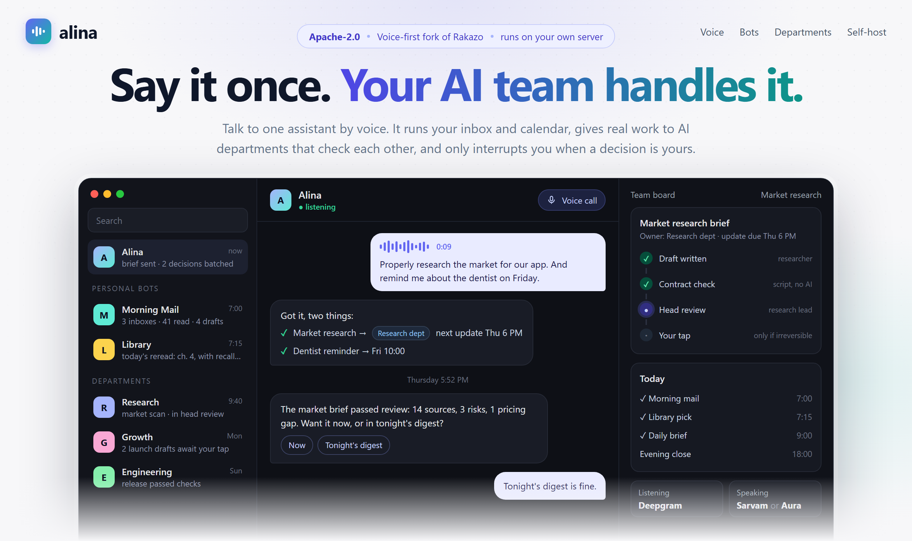

# Alina



**Alina is a voice-first AI chief of staff that runs on your own server.** You talk to one assistant. It handles your inbox, calendar and reminders, runs small personal bots for routine jobs, and hands real work to AI "departments" whose output is checked before it reaches you. Only Alina talks to you; everything else reports to her.

Alina is a fork of [Rakazo](https://github.com/elie222/rakazo) (Apache-2.0), the open-source, self-hosted alternative to Grok Bot. Everything Rakazo does still works here: persistent bots, routines, memory, computers with a browser and terminal, MCP tools, and the web, desktop and mobile apps. Alina adds voice providers, a way to run many bots behind one assistant, and the pieces needed to plug in a reviewed AI workforce. Where Alina is heading: [MISSION.md](./MISSION.md).

> **Status:** early and opinionated. It runs one owner's assistant in production on a single ARM64 server. Expect rough edges; the upstream Rakazo docs remain the reference for anything not covered here.

## What Alina adds to Rakazo

**Voice**
- **Deepgram** voice provider: speech-to-text (Nova-3) and text-to-speech (Aura voices).
- **Sarvam AI** voice provider: natural Indian English and Indian-language speech (Bulbul).
- **Separate listening and speaking.** `RAKAZO_TRANSCRIBE_PROVIDER=deepgram` makes every transcription use Deepgram, while the voice you hear can be Sarvam or Deepgram.
- **Server transcription in calls.** When transcription is pinned, the mobile app sends each call turn to the server instead of using on-device recognition. Barge-in still works.

**One assistant, many bots**
- **Silent background runs.** Webhook deliveries, bot-to-bot messages and follow-up runs that end with exactly `NO_RESPONSE` post nothing, so background bots never ping the owner.
- **Trusted tools for unattended runs.** `LIFEOS_WEBHOOK_TRUSTED_MCP_SERVERS` and `LIFEOS_WEBHOOK_TRUSTED_TOOLS` list the MCP servers and built-in tools a webhook run may use without the owner. Looking up tool schemas is always allowed, since it has no side effect. Tools that always need approval stay gated.
- **Longer bot instructions:** 48,000 characters, so a full operating manual fits in one bot.

**Models**
- **Kimi K3 on Amazon Bedrock** through the US inference profile `us.moonshotai.kimi-k3`, alongside Rakazo's keyless Bedrock support (`PI_DEFAULT_CREDENTIALS=host` with an instance role).

**Packaging**
- **An image overlay** (`infra/lifeos/Dockerfile`) that adds the Python and Node runtimes the extra MCP tool servers need, with pinned versions. No secrets or scripts are baked in; they are mounted at runtime.
- **Images built by GitHub Actions** for `linux/amd64` and `linux/arm64`: `ghcr.io/affanshaikhsurab/alina/app`, `.../app-lifeos`, `.../computer`, `.../updater`.

Every Alina change is opt-in: with the settings above left unset, Alina behaves like upstream Rakazo (apart from the higher instructions limit).

## How it fits together

```
You (phone, desktop or web) ── voice / chat ──► Alina (the one assistant)
                                                  │
                    ┌─────────────────────────────┼──────────────────────────────┐
                    ▼                             ▼                              ▼
            Personal bots                  Quick answers                 AI departments
   (mail summary, reading pick …)      (Alina, same turn)      (research, growth, engineering …)
     report to Alina, never you                                  work is checked, then reviewed;
                                                                 you approve only what can't be undone
```

The departments run outside Rakazo, in a task control plane such as [Paperclip](https://github.com/paperclipai/paperclip), connected through MCP and a webhook back to Alina. The deployment kit for that side is not in this repository yet.

## Quick start

Everything in Rakazo's [self-hosting guide](./docs/self-host.md) applies. To run Alina's images instead of Rakazo's, set these in `.env` before starting:

```bash
mkdir -p alina && cd alina &&
curl -fsSLO https://raw.githubusercontent.com/AffanShaikhsurab/alina/lifeos/v0.2.0-voice/infra/compose/install-images.sh &&
bash install-images.sh --prepare-only

# then edit .env:
RAKAZO_IMAGE=ghcr.io/affanshaikhsurab/alina/app          # or .../app-lifeos for the MCP runtimes
RAKAZO_IMAGE_TAG=sha-<commit>                            # pin a build; see the repo's packages
RAKAZO_COMPUTER_IMAGE=ghcr.io/affanshaikhsurab/alina/computer
RAKAZO_COMPUTER_IMAGE_TAG=sha-<commit>
RAKAZO_TRANSCRIBE_PROVIDER=deepgram                      # optional: always listen with Deepgram

bash install-images.sh
```

Open `http://127.0.0.1:5173`, create the owner account, connect a model, then add voice keys in **Settings → Voice** (Deepgram, Sarvam, or any upstream provider).

For a public server, put HTTPS in front of the web port and **close sign-ups after creating the owner account** ([guide](./docs/self-host.md#public-single-vm-deployment)).

### Voice settings

| Setting | Default | Meaning |
|---|---|---|
| `RAKAZO_TRANSCRIBE_PROVIDER` | unset | Provider every transcription uses once you connect it (e.g. `deepgram`). Speech keeps your default voice |
| `DEEPGRAM_STT_MODEL` | `nova-3` | Deepgram speech-to-text model |
| `DEEPGRAM_STT_LANGUAGE` | Deepgram's default | Deepgram language, e.g. `en-IN` |
| `SARVAM_TTS_MODEL` | `bulbul:v3` | Sarvam text-to-speech model |
| `SARVAM_TTS_LANGUAGE` | `en-IN` | Sarvam language code |

### Unattended-run settings

| Setting | Meaning |
|---|---|
| `LIFEOS_WEBHOOK_TRUSTED_MCP_SERVERS` | Comma-separated MCP server names whose tools a webhook run may call without the owner |
| `LIFEOS_WEBHOOK_TRUSTED_TOOLS` | Comma-separated built-in tools allowed in webhook runs (tools that always need approval stay gated) |

## Development

Same toolchain as Rakazo: Node, pnpm 9 (via corepack), TypeScript, Vitest, Biome, Prisma, Turbo.

```bash
corepack pnpm@9.15.0 install --frozen-lockfile
corepack pnpm@9.15.0 --filter @rakazo/db generate
pnpm check        # type check (needs pnpm on PATH: corepack enable)
pnpm lint         # biome
pnpm test         # vitest
```

The Alina changes have their own tests, in `packages/adapters/src/voice-factory.test.ts`, `apps/api/src/voice.test.ts`, `apps/mobile/lib/call-session.test.ts`, `packages/adapters/src/executor-completion.test.ts`, `packages/adapters/src/lazy-tool-catalog.test.ts` and `packages/core/src/action-approval.test.ts`.

Full local-development, desktop and mobile instructions are in Rakazo's original README: [docs/upstream/RAKAZO-README.md](./docs/upstream/RAKAZO-README.md).

## Staying in sync with Rakazo

The default branch `lifeos/v0.2.0-voice` tracks upstream `elie222/rakazo` `main`. Upstream is merged in regularly on a test branch. Changes are kept small and opt-in so merges stay clean. General improvements, like the voice providers, are good candidates to offer back upstream.

## License and credit

Apache License 2.0, the same as upstream ([LICENSE](./LICENSE)). Alina is built on [Rakazo](https://github.com/elie222/rakazo) by Elie Steinbock and contributors. Files changed for Alina carry a "LifeOS" note where they differ from upstream. The banner's source is [docs/alina/banner.html](./docs/alina/banner.html).
